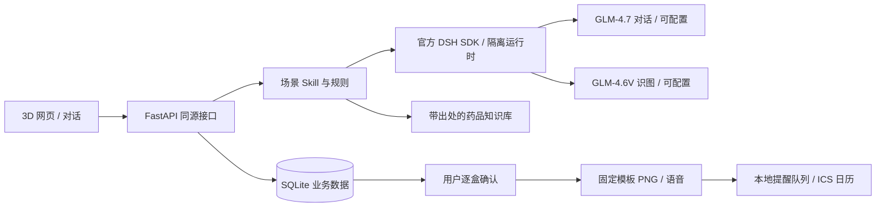

# 安伴本地后端

本地开发版，采用 FastAPI + SQLite。服务同时提供现有 3D 网页与 `/api/v1` 接口，默认只监听 `127.0.0.1`。本次没有修改或发布线上站点。

## 启动

在项目根目录执行：

```sh
python3 -m pip install -r requirements.txt
npm ci --prefix backend/dsh --ignore-scripts
python3 -m backend --port 8794
```

- 网页：<http://127.0.0.1:8794/>
- 交互接口文档：<http://127.0.0.1:8794/docs>
- OpenAPI：<http://127.0.0.1:8794/openapi.json>
- 服务状态与模型配置状态：<http://127.0.0.1:8794/api/v1/health>

Swagger 资源已放在 `backend/docs-assets/`，文档无需外部 CDN。旧药品知识库 `python3 app.py serve` 与静态原型服务可独立运行。

## 模型配置

模型配置保存在项目根目录的 `.env`。首次使用时复制 `.env.example` 为 `.env`，不要覆盖已有配置。默认示例按智谱国内开放平台配置 GLM：用编辑器打开 `.env`，在 `GLM_API_KEY=` 后填入自己的智谱 API 密钥并保存，然后重启 `python3 -m backend --port 8794`、刷新网页。密钥仅在本机配置，不填写到前端或提交到仓库。

```dotenv
ANBAN_AGENT_ENGINE=dsh
ANBAN_CHAT_PROVIDER=glm
ANBAN_VISION_PROVIDER=glm
GLM_API_KEY=在本机填写自己的智谱密钥
GLM_BASE_URL=https://open.bigmodel.cn/api/paas/v4
ANBAN_CHAT_MODEL=glm-4.7
ANBAN_VISION_MODEL=glm-4.6v
```

GLM-4.7 用于文字对话，GLM-4.6V 用于药盒和报告图片。模型名称可以按账户实际权限修改；文字模型不能仅靠更改接口格式获得识图能力。这里使用智谱通用 API，不自动把 Coding Plan 地址或其他平台凭据当作通用 API 使用。

对话与识图支持独立配置：`ANBAN_CHAT_PROVIDER` / `ANBAN_VISION_PROVIDER` 分别支持 `glm`、`deepseek`；可选的 `ANBAN_CHAT_API_KEY` / `ANBAN_VISION_API_KEY`、`ANBAN_CHAT_BASE_URL` / `ANBAN_VISION_BASE_URL` 可覆盖各自厂商默认值。没有单独覆盖时，GLM 只读 `GLM_API_KEY`，DeepSeek 只读 `DEEPSEEK_API_KEY`，不会跨厂商借用密钥。健康检查的 `chat_config`、`vision_config` 分别返回厂商、模型和是否配置密钥。

保留 DeepSeek 的示例：把对话厂商设为 `deepseek`、`ANBAN_CHAT_MODEL=deepseek-flash`，填写 `DEEPSEEK_API_KEY`；识图继续用 GLM，无需更改。DeepSeek 的 DSH 地址仍由 `ANBAN_DSH_BASE_URL`（默认 `https://api.deepseek.com/anthropic`）控制。旧的 `ANBAN_MODEL` 仅作为 DeepSeek 模型配置的兼容项；显式角色模型名优先。

密钥只在服务端和 DSH 子进程内使用，不放进命令行参数、前端、业务数据库、日志或接口返回。`.env` 已被 Git 忽略，初始文件权限为 600。健康检查只返回配置状态，不返回密钥。

### DSH 运行方式

实际接入官方 `@deepseek-ai/dsh@0.2.2-rc.5`，需要 Node.js 24.9 或更新版本。npm 包和依赖完整锁定在 `backend/dsh/package-lock.json`，只安装到项目内。由于官方 PyPI 暂无 SDK 安装包，Python 调用层使用固定提交的官方 SDK 原始源码，来源与 MIT 许可证见 `backend/dsh/sdk/NOTICE.md`。

`backend/harness.py` → 独立 worker → 官方 Python SDK → 官方 DSH `sdk-minimal` → 指定厂商。GLM 挂载官方 `@deepseek-ai/dsh-llm-pi-ai` 适配器，通过 Chat Completions 流式协议调用；DeepSeek 使用原官方适配器。两条路径都实际经过 DSH。`health.patch.yml` 关闭了终端、文件读取/写入、工作目录工具和自动重试；模型请求中工具列表为空。每次调用使用独立临时 Harness home，完成或超时后清理，SQLite 提供最近 16 条对话历史。Skill 提示进入 DSH 的系统提示，用户文字通过固定前缀和结构化对话资料传入，不能触发 DSH 斜杠命令。

调用最多并行 2 个，整个 worker 超时 90 秒；超时会终止子进程组。原始 SDK 错误不会直接回显。GLM 图片通过 `image_url` 内嵌 Base64 发送，不调用 DeepSeek Files API。DeepSeek 路径仍由官方适配器使用 Files API 或内嵌图片回退，其 Files 上传设置了 1 小时过期时间；这是服务商侧的过期设置，不代表本地数据库中的照片会被删除。

如果需要直连兼容模式，可设置 `ANBAN_AGENT_ENGINE=direct`，这时按角色使用 `GLM_BASE_URL` 或 `DEEPSEEK_BASE_URL` 的 Chat Completions 接口。GLM 对话和识图都显式关闭深度思考；结构化识图同时通过 Skill 提示和 JSON 字段校验约束输出，不能直接写入已确认吃法。

尚未配置密钥时，照片保存、人工核对、卡片、语音和提醒仍可使用；自由问答明确返回未配置状态，图片返回 `manual_required`。配置成功后重新上传照片即可识别，识别结果只填入候选药名，不替用户确认剂量和服药时间。

### 检查与真实联调

```sh
# 启动实际 DSH 并完成握手，不发送真实模型请求
python3 -m backend.check_ai

# 使用 .env 的密钥发起 5 次真实模型请求，会产生相应 API 用量
python3 -m backend.check_ai --live
```

真实联调依次测试两轮对话（包括历史记忆）、两张程序生成的测试药盒图片、一张模拟体检报告，使用隔离数据库，不读取或上传真实用户资料。每步验证真实返回后才显示通过。没有密钥时明确停止，不把模拟响应称作真实识别。本次已验证实际 SDK/Node 运行链路；真实服务商联调是否完成，以 `--live` 的结果为准。

参考协议：[智谱 OpenAI 兼容接口](https://docs.bigmodel.cn/cn/guide/develop/openai/introduction)、[GLM-4.7](https://docs.bigmodel.cn/cn/guide/models/text/glm-4.7)、[GLM-4.6V 视觉输入](https://docs.bigmodel.cn/cn/guide/models/vlm/glm-4.6v)、[DeepSeek 图片输入](https://api-docs.deepseek.com/guides/vision/)、[DSH Python SDK](https://github.com/deepseek-ai/deepseek-harness/blob/master/python/sdk/README.md)。

## 数据和调用顺序

业务数据库默认位于 `.run/health/health.sqlite3`，包括账户、会话、画像、图片、对话、草稿、卡片、报告和提醒。图片先验证实际格式和尺寸，再去除元数据、缩小并转为 JPEG，保存在数据库中。数据库和 `.env` 均已排除在 Git 之外。原有只读知识库仍使用 `.run/` 中的版本化目录。



1. `POST /session` 创建或恢复访客会话，返回 CSRF token，并设置 HttpOnly、SameSite=Strict cookie。
2. 后续写入请求带 `X-CSRF-Token` 和 `Content-Type: application/json`。浏览器不需要读取会话 cookie。
3. 注册会把当前访客数据保留到该账户。登录只读取对应账户；退出后创建空访客档案。此版本是本机账户，不是短信或微信登录。
4. 创建草稿，上传 2～5 张照片，可选执行识别，再把图片加入草稿。图片只生成候选药名及说明书原文，用量、每日时间和饭前饭后关系保持待人工核对。
5. 修改并提交药盒记录，逐盒设置 `ok: true`。更新时必须带上当前 `revision`，冲突返回 409。确认时间戳随记录保存。变更未确认时 `ok: false`。
6. 全部确认后把草稿置于 `summary`，用草稿 ID 和版本生成卡片。同一版本重复提交返回同一张卡，不重复创建。已生成卡片保留原确认内容，不跟随草稿修改。

## PDF 上传与识别

体检报告入口可选择图片或 PDF；用药卡的添加步骤另有“上传说明书 PDF”。PDF 由 `pypdfium2` 在本机解析，先生成预览，用户选页后再调用现有 DSH / 视觉模型。原文件不会作为附件直接传给模型，只有选中页的图片和最多 12,000 字符的文本层作为不可信参考发送。

- 每份 PDF 最多 8 MB、30 页，每轮选择 1～5 页。加密文件须先解锁；损坏、超时、页码越界会返回明确错误。
- 预览图长边最多 440 像素；识别图按 200 DPI 渲染，长边最多 3,000 像素。解析在独立子进程运行，最多并行 2 个，单次超时 30 秒。
- 报告结果按原页码分组，保留数值、单位、参考范围与原图标记；成功页不会因其他页失败而丢失，失败页可单独重试。已完成的识别结果可复用。
- 一份说明书的所选页面合并为一种药。不同药名不能自动合并；规格或厂家冲突时留空并要求核对。候选药名可回填，用量、时间、饭前饭后和确认状态均不自动确定。
- 原 PDF、预览、页面图、选择记录与识别结果保存在当前账户的 SQLite 数据库，刷新后可继续。已加入药品草稿的说明书页选择固定；需要其他页时重新上传。

`backend/tests/test_pdf.py` 使用真实 PDFium 和受控模型响应验证解析、汇总、隔离、重试及确认门槛。`backend/tests/fixtures/` 的 PDF 均为虚构测试数据，加密样例密码为 `test-password`，仅用于确认上传端会提示先解锁。

## 接口清单

路径均以 `/api/v1` 开头，字段类型以本机 OpenAPI 文档为准。

| 方法与路径 | 用途 |
| --- | --- |
| `GET /health`、`GET /skills` | 健康检查、模型状态、场景列表 |
| `POST /session` | 建立或恢复访客会话 |
| `POST /auth/register`、`/auth/login`、`/auth/logout` | 本地账户 |
| `GET /profile`、`PUT /profile` | 称呼、年龄、健康状况、过敏、忌口 |
| `GET /catalog?q=药名`、`GET /catalog/{id}` | 带版本和来源的药品查询 |
| `GET /conversation` | 当前会话与已保存消息 |
| `POST /conversations/{id}/messages` | 对话和功能路由，`request_id` 保证重试幂等 |
| `POST /uploads` | 上传 `{data_url, kind}`，kind 为 medicine 或 report |
| `GET /uploads/{id}/image` | 仅当前账户可访问的照片 |
| `POST /uploads/{id}/analyze` | 药盒或报告原文识别，结果待核对 |
| `POST /documents` | 上传 PDF：`{filename, data_url, kind}`，`data_url` 为 PDF Base64 |
| `GET /documents`、`GET /documents/{id}` | 恢复 PDF、所选页与每页识别状态 |
| `PUT /documents/{id}/selection` | 保存选择：`{pages:[1,2]}`，页码从 1 开始 |
| `GET /documents/{id}/pages/{page}/preview`、`/image` | 仅当前账户可访问的预览和完整页面图 |
| `POST /documents/{id}/pages/{page}/analyze` | 识别一个已选择的页面；失败可重试 |
| `POST /drafts`、`GET /drafts` | 创建及恢复最近核对进度 |
| `POST /drafts/{id}/uploads/{upload_id}` | 把自己的药盒照片加入草稿 |
| `POST /drafts/{id}/documents/{document_id}` | 将同一份 PDF 的已识别说明书页合并为一种待核对药品 |
| `PUT /drafts/{id}` | 更新字段、确认状态和步骤 |
| `POST /cards`、`GET /cards` | 创建不可变用药卡、查看卡片 |
| `GET /cards/{id}/image.png` | 服务器生成的大字 PNG |
| `POST /cards/{id}/audio`、`GET /cards/{id}/audio` | 生成及播放语音 |
| `POST /reports`、`GET /reports` | 报告识别记录和通用箭头解读，不诊断 |
| `POST /reminders`、`GET /reminders` | 基于正式用药卡设置每日提醒 |
| `PATCH /reminders/{id}` | 暂停或重新开启 |
| `GET /reminders/calendar.ics` | 导出当前启用的日历提醒 |
| `GET /reminder-events`、`POST /reminder-events/{id}/ack` | 到点事件与已读确认 |

写入空请求体的操作也需要 `{}`。典型错误使用 `{"error":{"code":422,"message":"…"}}`；字段校验失败还会返回字段名，不回显密码、照片或模型响应原文。

## Skill 与医疗边界

`backend/skills/` 下的四个 Skill 由运行时实际读取。对话、药盒识别和体检提取分别使用自己的提示。卡片和提醒由固定业务逻辑生成，模型不能直接写入确认状态、改动剂量或安排提醒。

目录检索保留原知识库出处。体检功能目前提取项目、原值、单位、原参考范围和箭头，并附通用解释；尚未实现独立的临床指标诊断知识库。识别候选不是诊断，也不是处方。药盒说明书中的通用用法不会自动当成用户的服药剂量。

每盒最多登记三个每日固定服用时点，且各自保留时间、用量及用餐关系。非每日或按需安排仍按原医嘱管理。含糊用量、无效时间、未确认记录和示例卡均被拦截，示例卡不能设置正式提醒。所有正式卡片保留“不替代执业医师诊断与处方调整”。

## 语音和每日提醒

配置千问 TTS 后优先合成不足一分钟的 WAV。接口失败时，Windows 使用已安装的中文 SAPI 音色，macOS 使用 Tingting。两种路径均不可用时，网页提供浏览器朗读。用药卡在保存音频后复用，报告卡每次生成摘要，定时提醒复用通用语音。

PNG 使用本机中文字体；Linux 可以设置 `ANBAN_FONT_PATH` 指向 Noto Sans CJK 等字体。没有中文字体时会返回明确错误，不生成乱码图片。

后台每 10 秒扫描提醒，事件持久化且同一个时间点只生成一次；网页每 30 秒读取未读事件。暂停提醒或替换安排会取消未读旧事件。应用退出后仍可通过已导入手机日历的 ICS 提醒；本版没有微信、短信、邮件或浏览器关闭后的 Web Push。导入后的手机日历与本地数据库独立，修改安排时需同时更新日历中的旧事件。服务器停机恢复时最多展示最近 24 小时的到点事件，不生成“补服”建议。

## 验证

```sh
python3 -m unittest discover -s backend/tests -v
python3 -m unittest discover -s tests -v
ANBAN_TEST_DSH=1 python3 -m unittest backend.tests.test_dsh_runtime -v
ANBAN_TEST_DSH=1 python3 -m unittest backend.tests.test_glm_runtime -v
```

测试覆盖实际 HTTP 请求、账户隔离和 CSRF、图片真实格式、识别候选与确认分离、乐观锁、重复提交、卡片 PNG、语音回退、日历、提醒事件去重及暂停、原知识库回归。DSH 集成测试启动官方 SDK 与实际 Node 运行时，仅用本机模拟 HTTP 服务替代外部模型，检查历史传递、零工具、图片文件/内嵌路径、候选回填、超时、截断和错误处理。浏览器端另行验证完整上传→逐盒确认→刷新续接→卡片→语音→提醒，以及注册、退出和再次登录的数据恢复。

当前运行方式是本地开发服务。公网部署、找回密码、跨设备同步入口与真实医学场景的识别效果验收仍需单独配置和测试。
